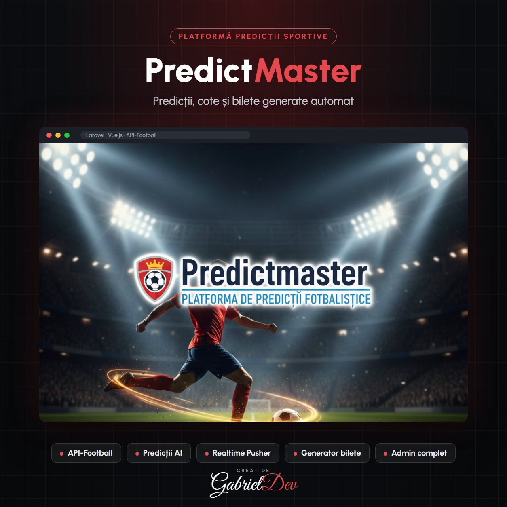

  

<h1 align="center">PredictMaster</h1>

Un proiect complex dedicat predicțiilor sportive, integrat cu API-Football.

| | |
|---|---|
| **Client** | Client privat |
| **An** | 2025 |
| **Domeniu** | Frontend Development |
| **Status** | Livrat (site-ul nu mai este online) |
| **Studiu de caz** | [gabrieldev.eu](https://gabrieldev.eu/portofoliu/predictmaster) |

---

#### Description

PredictMaster este o platformă avansată de predicții sportive, creată pentru a oferi utilizatorilor o experiență completă în analizarea meciurilor, vizualizarea cotelor și generarea biletelor. Proiectul a implicat dezvoltarea unei interfețe intuitive, integrarea API-Football și implementarea unui sistem inteligent de predicții automatizate.

#### Key Features

- Import Automat Meciuri: Integrare completă cu API-Football pentru importul meciurilor live și viitoare.
- Cote & Predicții AI: Sistem automat care preia cotele și generează predicții inteligente pe baza datelor și algoritmilor interni.
- Generator de Bilete: Funcționalitate dedicată pentru generarea biletelor de pariuri, inclusiv bilete cu cotă mică.
- Interfață Realtime: Afișare live matches prin Vue.js, cu actualizări instant folosind Pusher.
- Panou Admin Complet: Administrare cote, predicții manuale și meciuri direct din dashboard.

#### Technologies Used

- Front-End: Blade + Vue.js pentru interfața dinamică și actualizări realtime.
- Back-End: Laravel pentru API intern, importuri automate și logica centrală.
- Database: MySQL pentru stocarea meciurilor, cotelor și predicțiilor.
- APIs: API-Football pentru date sportive și cote.
- Realtime: Pusher pentru actualizări instant în homepage.

#### Design Highlights

- UI Modernă: Focus pe claritate, simplitate și acces rapid la informații sportive.
- Accesibilitate: Navigare ușoară, carduri cu cote clare și layout optimizat.
- Responsivitate: Design complet adaptat pentru mobil, tabletă și desktop.

---

## 🔒 Despre cod

Acesta este un repository de **prezentare**. Codul sursă aparține clientului și nu este public — aici găsești descrierea proiectului, funcționalitățile și tehnologiile folosite.

## 🤝 Ai nevoie de ceva asemănător?

Proiect realizat de **[Gabriel Dev](https://gabrieldev.eu)** — creare site-uri, magazine online și aplicații web personalizate.

- 🌐 [gabrieldev.eu](https://gabrieldev.eu) · [toate proiectele](https://gabrieldev.eu/proiecte)
- ✉️ [contact@gabrieldev.eu](mailto:contact@gabrieldev.eu)
- 📞 [+40 743 543 100](tel:+40743543100)
